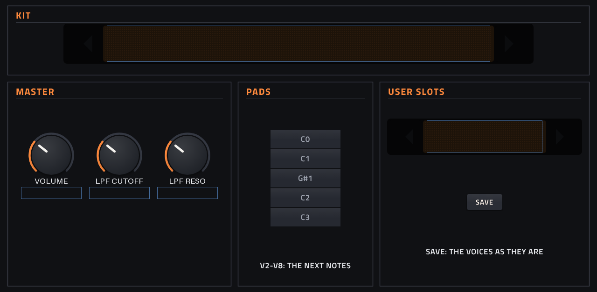
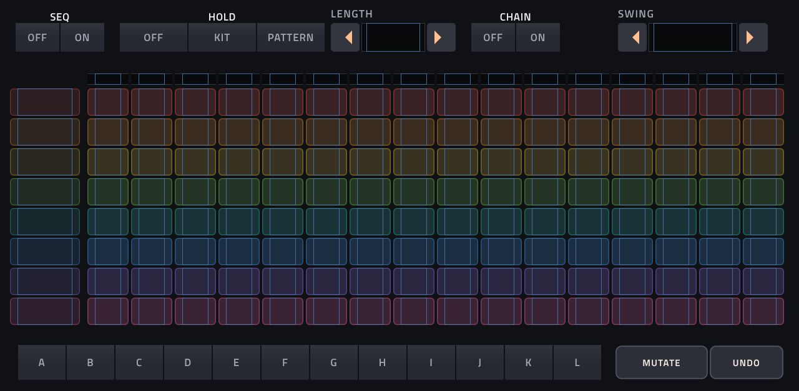
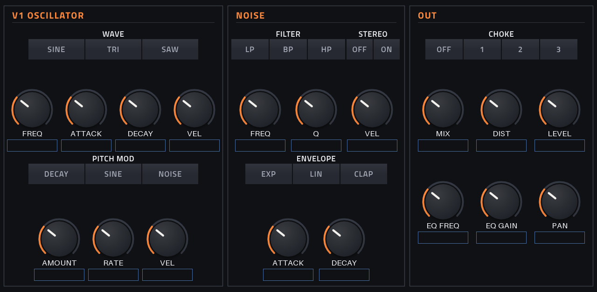
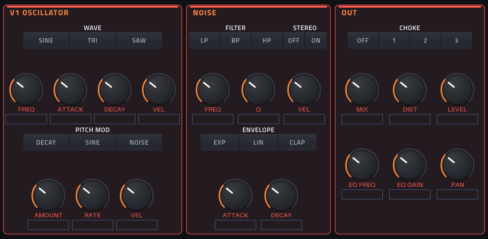

# Drumbox

**Drum-Synth** · Acht synthetische Drum-Stimmen für Akai Force / MPC, nachgebaut nach
[nb_tonic](https://github.com/sonocircuit/nb_tonic) (sonocircuit) bzw. dessen Vorlage
[supertonic](https://github.com/schollz/supercollider-microtonic) (Zack Scholl), beide inspiriert von Sonic Charge
Microtonic. Lädt **Microtonic-Presets (`.mtpreset`, z. B. aus dem Patternarium)**, **Microtonic-Drum-Sounds
(`.mtdrum`)** und **nb_tonic-Kits (`.tkit`)**, hat einen **eingebauten Sequencer** mit den Patterns A–L der
Presets (alle acht Spuren auf einen Blick, synchron zur Force), **HOLD** zum Weiterblättern bei festem Kit oder
festem Pattern, **EXPLORE** (Presets mit ähnlichem Sound oder ähnlichem Groove finden, MUTATE, UNDO), einen
**Preset-Browser mit Vorhören**, einen **Favoritenordner** und **32 eigene Speicherplätze**. Jede der acht Spuren
hat ihre Farbe, im Sequencer wie auf ihrer Stimmen-Seite.
Mit ausgeschaltetem Sequencer spielt der Force-Sequencer die Stimmen, jede auf ihrer eigenen Note.
· Lizenz: MIT ([`LICENSE`](LICENSE))






**Keine Emulation.** Microtonics DSP ist nicht öffentlich. Drumbox ist eine C-Umsetzung von nb_tonics
SuperCollider-SynthDef (`lib/nb_tonic.sc`), Zeile für Zeile. Scholl hat seine Fassung nach Gehör gegen Microtonic
abgeglichen („very close“). Ein Microtonic-Preset klingt in Drumbox also ähnlich, aber nicht identisch.
Gegen echte Microtonic-Stems (VT-78 In The Air, VT-LM2 Like A Record) gemessen sind Scholls +5 Hz, halbierte MOD AMT,
Rausch-Decay ×1,4, Rauschen −9 dB und Rauschen statt Oszillator im NOISE-Modus entfernt; der halbierte EQ bleibt.
Verzerrung und Clap-Hüllkurve sind an diese Stems angepasst.

## Auf der Force

- Im Plugin-Browser: **[DRUM] Drumbox** von **lunarscraper** (Drum Machine)
- Installiert wird ein Ordner: `/sdcard/Synths/lunarscraper - VST - [DRUM] Drumbox/` mit `drumbox.so`, Skin und
  dem Datenordner `drumbox/` (eigene Kits und die Speicherplätze; bleibt bei Updates erhalten)
- 424 Parameter auf 13 Seiten (MASTER, PATTERN, EXPLORE, NOTES, SOUNDS, V1–V8), jede Stimmen-Seite mit drei
  Q-Link-Bänken (OSC, NOISE, OUT)
- Kits im PRESET-Menü der Force und auf der MASTER-Seite unter KIT

## Spielen

- **Noten 36–43 (C1–G1)** spielen die Stimmen 1–8, auf jedem MIDI-Kanal. Das sind die ersten acht Drum-Pads
  der Force. **V1 NOTE** (MASTER-Seite) legt alle acht in einer Reihe neu: C0, C1, **G#1 (Pads 9–16)**, C2, C3.
- Seite **NOTES**: jede Stimme auf eine **eigene Note** (C-2 bis G8). Liegen zwei Stimmen auf derselben Note,
  spielen beide. Damit passt Drumbox zu einem Force-Clip oder einem Drum-Layout, das andere Noten benutzt.
- **Velocity** wirkt über die drei VEL-Regler je Stimme (Oszillator, Rauschen, Pitch-Modulation; 0–200 %): bei Velocity 127 (Akzent) volle Stärke, darunter um VEL % weniger (wie Microtonic).
- Jeder Schlag ist ein One-Shot: Note-Offs werden ignoriert.
- Ein neuer Schlag einer Stimme blendet ihren vorigen in 50 ms aus (wie nb_tonic).
- **CHOKE 1–3**: Stimmen in derselben Gruppe würgen sich gegenseitig ab (z. B. offene und geschlossene Hi-Hat).
  OFF = nur die eigene Stimme.
- **MIDI-CC** (jeder Kanal), z. B. von einem Controller oder aus der Automation einer MIDI-Spur:

  | CC | Wirkung |
  |---|---|
  | 102–109 | **Mute V1–V8**: Wert 64–127 = stumm, 0–63 = spielt (wie die linke Spalte der Matrix) |
  | 110 | **Pattern**: Wert 0–11 = A–L (beim Spielen am Ende des laufenden Patterns, wie ein Tippen auf A–L) |
  | 120 / 123 | alles stoppen |
  | 20–35 | Q-Links der MASTER-Seite |
  | NRPN | jeder Parameter (wie in allen Plugins mit diesem Framework) |

  Für Taster am Controller: auf „Toggle“ (Umschalten) stellen, dann sendet er abwechselnd 127 und 0.

## Sequencer (Seite PATTERN)

Jedes Microtonic-Preset bringt zwölf Patterns (A–L) mit. Drumbox spielt sie selbst, alle acht Spuren in einer
Matrix: eine Zeile pro Stimme in ihrer Farbe (V1 rot, V2 orange, V3 gelb, V4 grün, V5 türkis, V6 blau, V7 violett,
V8 pink; dieselbe Farbe trägt die Stimmen-Seite), 16 Schritte. Gesetzte Schritte leuchten in der Spurfarbe.

1. **SEQ ON** und auf der Force **PLAY**. Drumbox läuft mit der Songposition der Force: startet, stoppt, springt
   und loopt mit ihr, jeder Schritt sampelgenau, im Tempo der Force. Die Spur braucht dafür keinen Clip.
2. Unten **A–L** wählt das Pattern. Während die Force spielt, kommt das neue Pattern am **Ende des laufenden**
   (wie bei Microtonic), sonst sofort (mit PREVIEW ON hörst du es dann gleich).
3. **Tippen auf ein Feld:** aus → an → **Akzent** (zeigt „A“) → aus. Akzente spielen mit Velocity 127, die übrigen
   Schläge mit 96. Felder hinter LENGTH zeigen „-“.
4. Die **linke Spalte (V1–V8)** schaltet Stimmen stumm (leuchtet = spielt, dunkel = stumm). Die schmale Zeile über der Matrix zeigt
   den laufenden Schritt.
5. **LENGTH** (1–16 Schritte) gilt für das gewählte Pattern. **SWING** (0–100, in 5er-Schritten; Q-Link: Bank
   PATTERN) verzögert jeden zweiten Schritt um bis zu einen halben Schritt.
6. **CHAIN ON:** Patterns, die im Preset verkettet sind (Microtonics „Chained“), laufen nacheinander, nach dem
   letzten der Kette wieder das erste. CHAIN OFF: das Pattern wiederholt sich. Jeder Start, Loop oder Sprung der Force beginnt beim
   gewählten Pattern, nicht bei dem, an dem die Kette beim Stoppen gerade stand. Beim Stoppen springt die Anzeige
   zurück auf das gewählte Pattern.

7. **MUTATE** und **UNDO** unten rechts: wie auf der Seite EXPLORE (unten), für das gewählte Pattern, ohne die
   Matrix zu verlassen.

Die Schrittweite kommt aus dem Preset (StepRate 1/16, auch 1/8 oder 1/32), ebenso Tempo (nur fürs Vorhören, die
Force gibt das Tempo vor), Swing und Mutes.

**HOLD** (für das Blättern im Live-Betrieb):

| HOLD | ein anderes Kit wählen … |
|---|---|
| OFF | lädt Sounds **und** Patterns des Kits |
| KIT | behält die Sounds, lädt nur die **Patterns** (neue Grooves für dein Kit) |
| PATTERN | behält die Patterns, lädt nur die **Sounds** (dein Groove mit anderem Kit) |

Blätterst du mit HOLD OFF, während die Force spielt, wechselt das Kit sofort, das Pattern des neuen Presets folgt
am Ende des laufenden.

**Mit dem Force-Sequencer statt des eingebauten:** SEQ OFF, dann spielen nur Noten. Auf der Seite NOTES legst du
fest, welche Note welche Stimme spielt.

## Ähnliches finden und mutieren (Seite EXPLORE)

Wie im Patternarium: von einem Preset aus zu ähnlichen weitergehen. Beim Einfügen liest Drumbox im Hintergrund alle
Presets einmal ein (oben rechts: „READING 312 / 738 PRESETS“; offline 0,7 s für 738, auf der Force etwas länger),
danach zeigt die Seite:

- **SIMILAR SOUND:** die sechs Presets, deren acht Klänge den jetzigen am nächsten sind (Tonhöhe, Abklingzeiten,
  Mix, Rauschfilter wiegen am meisten). **Tippen übernimmt nur die Klänge**, die Patterns bleiben.
- **SIMILAR GROOVE:** die sechs Patterns aus anderen Presets, die dem gewählten Pattern am nächsten sind, mit dem
  Buchstaben des Patterns („Antine Inrig  J“). Verglichen wird Spur für Spur, ein Schlag einen Schritt daneben zählt
  halb; Kick, Snare und Hi-Hats (V1, V5, V7, V8, ihre üblichen Plätze im Patternarium) zählen mehr. **Tippen
  übernimmt nur die Patterns** (alle zwölf des Presets, das ähnliche ausgewählt), die Klänge bleiben.

Die Listen bleiben stehen, während du durchprobierst; das übernommene Feld leuchtet. **SEARCH HERE** sucht neu vom
jetzigen Stand aus (so gehst du Schritt für Schritt weiter). Neu gesucht wird auch, wenn du ein Kit oder Pattern
wählst oder mutierst. Mit PREVIEW ON und gestoppter Force hörst du jede Übernahme sofort.

**MUTATE** verändert zufällig, **AMOUNT** (5–100 %, Q-Link) sagt wie stark, **MUTATE VOICES** welche Stimmen (ALL oder
eine):
- **MUTATE SOUND:** jeder Regler der Stimmen verschiebt sich ein Stück (Level und Pan weniger), ab und zu wechselt
  eine Auswahl (Wellenform, Filter, Hüllkurve).
- **MUTATE GROOVE:** im gewählten Pattern wandern Schläge um einen Schritt, fallen weg, kommen dazu (bevorzugt dort,
  wo die anderen Patterns des Presets spielen, sonst auf dem Beat), Akzente kippen. Die Dichte jeder Spur bleibt
  ungefähr, die anderen Patterns bleiben unberührt.

**UNDO** geht bis zu 16 Schritte zurück: Mutationen, Übernahmen und auch ein Kit-Wechsel. Gefällt das Ergebnis:
**SAVE** in einen Speicherplatz (MASTER-Seite).

## Presets durchhören (Browser)

Für viele Presets (z. B. 600 aus dem Patternarium): Dateien in einen Unterordner von `drumbox/` legen (siehe
unten), Drumbox einfügen, dann auf der **MASTER**-Seite:

1. Mit den **Pfeilen** am KIT-Feld (oder im PRESET-Menü) zum nächsten Preset. Mit **PREVIEW ON** spielt Drumbox
   dabei sofort das **gewählte Pattern** (zuerst das Startpattern des Presets, meist A) zweimal ab: im Tempo der Force, Akzente lauter, die Mutes des Presets
   beachtet. Presets ohne Pattern (nb_tonic-Kits, Speicherplätze ohne Pattern) spielen ihre acht Stimmen
   nacheinander. **PLAY** spielt es noch einmal.
2. Gefällt es: **FAVORIT**. Die Originaldatei (mit allen Patterns) wird nach `drumbox/Favoriten/` kopiert und
   erscheint sofort als „FAV <Name>“ am Ende der Kit-Liste, nach dem nächsten Einfügen alphabetisch einsortiert.
   Sonst einfach weiter zum nächsten.

Das Vorhören läuft nur, solange die Force **nicht spielt**, und endet, sobald du ein Pad spielst, ein anderes Kit
wählst oder PLAY auf der Force drückst. Zum Mitspielen mit der Force gibt es den Sequencer (oben).

**Mit den Pads blättern (PAD BROWSE ON, MASTER-Seite):** Die Pads 9–16 bedienen dann den Browser. Pads 9–15 gehen
nur, solange die Force nicht spielt, damit ein Clip mit diesen Noten nie das Kit wechselt. Pad 16 (nächstes
Pattern) geht auch beim Spielen. Eine Note, auf der eine Stimme liegt (NOTES), spielt immer die Stimme:

| Pad (bei V1 NOTE = C1) | Note | Funktion |
|---|---|---|
| 9 / 10 | G#1 / A1 | Kit zurück / vor (mit Vorhören) |
| 11 | A#1 | FAVORIT |
| 12 | B1 | Pattern noch einmal (PLAY) |
| 13 / 14 | C2 / C#2 | Sound zurück / vor (SOUNDS-Seite, mit Anspielen) |
| 15 | D2 | TAKE (Sound in die gewählte Stimme) |
| 16 | D#2 | nächstes Pattern (A → B → … → L → A), beim Spielen am Ende des laufenden |

Ein Q-Link blättert KIT nicht einzeln (ein Ruck wären 16 Kits), deshalb liegen KIT und SOUND auf keinem Q-Link.

## Einzelne Sounds (.mtdrum, Seite SOUNDS)

`.mtdrum`-Dateien (ein Microtonic-Drum-Sound, `MicrotonicDrumPatchV3`) legst du wie die Presets in `drumbox/` oder
einen Unterordner, z. B. `drumbox/Sounds/`. Der Name kommt aus dem Dateinamen. Auf der Seite **SOUNDS**:

1. Mit den Pfeilen durch die Sounds blättern. Jeder Schritt spielt den Sound auf einer eigenen Vorhör-Stimme an,
   das Kit bleibt dabei unverändert. **PLAY** spielt ihn noch einmal.
2. Unter **TO VOICE** die Zielstimme wählen (V1–V8), **TAKE** übernimmt den Sound in diese Stimme. Ihre
   CHOKE-Gruppe bleibt, alles andere wird ersetzt.
3. Das so zusammengestellte Kit mit **SAVE** in einen Speicherplatz sichern.

## Die Stimme

Pro Stimme, in der Reihenfolge des Signals:

| Teil | Regler | Was passiert |
|---|---|---|
| **Oszillator** | WAVE (SINE/TRI/SAW), FREQ, ATTACK, DECAY, VEL | Hüllkurve exponentiell; spielt genau auf FREQ (wie Microtonic, ohne Scholls +5 Hz) |
| **Pitch-Mod** | DECAY / SINE / NOISE, AMOUNT (±96 Halbtöne, volle Wirkung, nicht halbiert wie in nb_tonic), RATE, VEL | DECAY: RATE ist die Abklingzeit (ms, „INF“ = keine), SINE / NOISE: Hz. NOISE moduliert die Tonhöhe mit Zufallswerten; AMOUNT 0 = reiner Ton (wie Microtonic; nb_tonics Ersatz des Oszillators durch Rauschen entfällt) |
| **Rauschen** | FILTER (LP/BP/HP), FREQ, Q, STEREO, ENVELOPE (EXP/LIN/CLAP), ATTACK, DECAY, VEL | DECAY wie eingestellt (ohne nb_tonics ×1,4), Pegel ohne −9 dB; bei hohem Q blendet das Filter in einen Sinus auf seiner Frequenz über; CLAP (Microtonics „Mod“): Salven etwa alle 5 ms während ATTACK, danach 60 dB Abfall über DECAY |
| **Ausgang** | MIX, DIST, EQ FREQ, EQ GAIN, LEVEL, PAN, CHOKE | MIX 100 = nur Oszillator, 0 = nur Rauschen (Microtonic-Konvention), Anteile m^1,5 und (1−m)^1,5. DIST: übersteuerte Stufe (bis +54 dB, leicht asymmetrisch), verzerrter Anteil = DIST, an Microtonic-Stems angepasst; die Hüllkurven klingen dafür bis −140 dB aus, damit nichts abreißt. EQ GAIN in Microtonics Skala (±40 dB; wirkt mit der Hälfte bei tiefen bis drei Viertel bei hohen Frequenzen). LEVEL über 0 dB klingt wie 0 dB (wie Microtonic) |

**MASTER:** VOLUME, LPF CUTOFF und LPF RESO (Tiefpass auf die Summe, wie nb_tonics globales Filter).

## Kits

Die Liste (PRESET-Menü und KIT) hat immer diese Reihenfolge, damit eine Nummer immer dasselbe Kit meint:

1. **Eingebaut (9):** Init (nb_tonics default), nb ARCHER, nb DISTEC, nb KROUMN, nb LODEKA und vier
   Patternarium-Presets: PA Unmouth Sphing, PA Isober Bewee, PA Apolid Pseudosteo, PA Perlike Epithel
2. **U01–U32:** deine Speicherplätze (`drumbox/USER/01.mtpreset` … `32.mtpreset`)
3. **Alle `.mtpreset`- und `.tkit`-Dateien** im Datenordner `drumbox/` und eine Ordnerebene darunter, alphabetisch
   nach Ordner und Datei; die in `Favoriten/` als „FAV <Name>“. Bis zu 2048 Kits.

Die Namen kommen aus dem Dateinamen („Unmouth_Sphing_139.mtpreset“ wird zu „Unmouth Sphing“). Gelesen wird eine
Datei erst, wenn du sie anwählst. So bleibt das Einfügen auch mit 600 Presets schnell (offline gemessen: 641 Kits in
10 ms gelistet, ein Preset in 0,5 ms gelesen; auf der SD-Karte der Force etwas langsamer).

### Speichern (32 Plätze)

MASTER-Seite, Feld **USER SLOTS**: mit den Pfeilen (oder dem Q-Link) den Platz wählen, **SAVE** tippen. Gespeichert
werden alle acht Stimmen so, wie sie gerade eingestellt sind, als **Microtonic-Preset** (`USER/NN.mtpreset`),
dazu alle zwölf Patterns, wie sie in der Matrix stehen, mit Längen, Ketten, Swing und Mutes. Der
Platz heißt danach „U05 <Kitname>“ und erscheint sofort in der Kit-Liste. Ein Projekt speichert seine Einstellungen
ohnehin selbst. Die Plätze sind für Kits, die du in anderen Projekten wiederfinden willst.

### Eigene Presets aus dem Patternarium laden

1. Im Patternarium ein Pattern mit dem Download-Knopf als `.mtpreset` speichern. Mit aktivem Favoriten-Filter lädt
   der Knopf alle Favoriten einer Generation als ZIP. Das ZIP am PC entpacken.
2. Die `.mtpreset`-Dateien in den Datenordner kopieren. Vom PC aus (Eingabeaufforderung oder PowerShell, im Ordner
   mit den Dateien; `<force-ip>` durch die IP-Adresse der Force ersetzen):
   ```
   ssh root@<force-ip> "mkdir -p '/sdcard/Synths/lunarscraper - VST - [DRUM] Drumbox/drumbox/Patternarium'"
   scp *.mtpreset "root@<force-ip>:/sdcard/Synths/lunarscraper - VST - [DRUM] Drumbox/drumbox/Patternarium/"
   ```
   Ein Unterordner (hier `Patternarium`) hält Ordnung. Gelesen wird `drumbox/` selbst und **eine** Ebene darunter
   (`drumbox/G02/Datei.mtpreset` ja, `drumbox/Patternarium/G02/Datei.mtpreset` nein). Bis zu 2048 Kits insgesamt.
3. Drumbox von der Spur entfernen und neu einfügen: Die Kits werden beim Einfügen gelesen.

Microtonics eigene Presets (auch das neuere Format mit `Key: Wert Einheit` und Anführungszeichen) lassen sich
genauso laden. Gelesen werden die acht Klänge und alle zwölf Patterns (Trigger, Akzente, Länge, Kette) mit Startpattern, Tempo,
StepRate, Swing und Mutes. Fills nicht. Der Tempo-Zusatz im Namen („(139)“) wird abgeschnitten. nb_tonic-Kits (`.tkit`) gehen genauso.

Rechte: Patternarium-Patterns sind laut Sonic Charge gemeinfrei (public domain). Die vier eingebauten stammen von
dort, nb_tonics Kits stehen unter MIT (`kits/nb_tonic/LICENSE`).

## Unterschiede zu Microtonic

- Sequencer ohne Fills und ohne Microtonics Pattern-Mutation; SWING ist eine Näherung (jeder zweite Schritt bis zu
  einem halben Schritt später)
- Keine getrennten Ausgänge A/B (MPC spielt nur das erste Stereo-Paar eines Plugins)
- Fills spielt Drumbox nicht (Microtonic spielt sie mit, wenn Fill aktiv ist)
- Klang nah dran, nicht identisch (siehe oben)

## Installieren

Aus einem Release: `DRUM-Drumbox-<version>-mpc-armv7.zip` auf die Force kopieren, entpacken und im entpackten Ordner
als root `sh install.sh` ausführen. Der Installer stoppt die MPC-Software, sichert `MPC.settings`, installiert den
Plugin-Ordner und startet neu. `INSTALL.md` im ZIP beschreibt das ausführlich.

## Bauen (GitHub Actions)

1. Repo zu GitHub hochladen (z. B. `lunarscraper/mpc-vst-drumbox`).
2. **Actions → „Release (draft)“ → Run workflow**, Version eintragen (z. B. `0.1.0`).
3. Der Workflow baut mit den Werkzeugen aus
   [saustin2010/mpc-vst-plugins](https://github.com/saustin2010/mpc-vst-plugins) (Commit `eaef502`, derselbe wie
   bei Percolator) die ARM-Bibliothek und den Skin, führt den Host-Test aus und legt einen Release-Entwurf mit dem ZIP an.
4. ZIP auf der Force installieren und testen, danach den Entwurf veröffentlichen.

Lokal (mit Docker): `python3 mpc/gen.py`, dann `bash "$MPC_VST/tools/build_port.sh" vst.json` und
`bash "$MPC_VST/tools/test_port.sh" vst.json`.

## Wie es gemacht ist

| Datei | Inhalt |
|---|---|
| `src/voice.c` | die Stimme (nb_tonics SynthDef in C), die Regler-Kurven |
| `src/kits.c` | Kit-Liste (träges Laden), `.mtpreset`-, `.mtdrum`- und `.tkit`-Leser, Umrechnung der Einheiten, SAVE, FAVORIT |
| `src/explore.c` | EXPLORE: Index-Thread, Ähnlichkeit von Sound und Groove, MUTATE, UNDO |
| `src/drumbox.c` | Parameter, MIDI (Note je Stimme), Kit-Wechsel mit HOLD, Sequencer, Matrix, Vorhören, PAD BROWSE, Master (VOLUME, LPF), Zustand, Anzeigen |
| `mpc/art.py` | zeichnet die großen Touch-Knöpfe (`images/`; von Hand ausführen, braucht Pillow) |
| `src/dsp.h` | Biquads wie SuperColliders BLowPass/BBandPass/BHiPass/BPeakEQ, softclip, Sinus-Tabelle |
| `mpc/gen.py` | schreibt `params.json`, `src/params_def.h`, `layout.conf` und `src/builtin_kits.h` aus einer Liste |
| `mpc/render.c` | Offline-Renderer: jedes Kit, jede Stimme einzeln und ein Groove als WAV, mit Pegeln |
| `kits/` | die Quellen der eingebauten Kits |
| `drumbox.css` | das Aussehen des Skins (HTML-Renderer des Frameworks) |

Die Parameter-Reihenfolge ist der VST-Index, über den Projekte und Q-Links gespeichert werden: neue Parameter nur
hinten anhängen (`mpc/gen.py`).

## Status (0.4.1, 2026-10-25)

0.4.1 (offline geprüft, **noch nicht auf der Force**): Klang gegen echte Microtonic-Stems abgeglichen
(VT-78 In The Air, Stimme für Stimme, Force-Transport bei 95 BPM nachgestellt):

- Ketten: Start, Loop und Sprung der Force beginnen beim gewählten Pattern. Vorher begann die Kette A→B nach dem
  ersten Stopp mit B, weil der Sequencer die Auswahl auf das laufende Pattern setzte. Beim Stoppen (auch SEQ OFF) springt
  die Auswahl zurück auf das gewählte Pattern.
- Drumbox Pocket (Browser-Artefakt) hat dieselbe Engine-Korrektur bekommen.
- Stimme: ohne nb_tonics +5 Hz, ohne Rauschen statt Oszillator im NOISE-Modus, MOD AMT in voller Stärke,
  Rausch-Decay ohne ×1,4, Rauschzweig ohne −9 dB, Oszillator linear bis Vollaussteuerung. EQ bleibt halbiert
  (ein zweites Kit, VT-LM2 Like A Record, zeigte das). Neu: Verzerrung als übersteuerte Stufe, Clap-Hüllkurve
  (Mod) mit Salven alle ~5 ms und 60 dB Abfall – Hi-Hat, Snare, Clap und Conga treffen jetzt die Hüllkurven. Ergebnis: Tonhöhen
  exakt, Conga wieder ein Ton (208 Hz) statt Rauschen, Pegel aller Stimmen auf ±3 dB, Decays von CY und Maracas
  wie in Microtonic.
- Drittes Kit (VAX Progressive Trance 3): LEVEL über 0 dB wirkt wie 0 dB, Velocity voll bei Akzent und weniger ohne,
  EQ frequenzabhängig (½ tief bis ¾ hoch) – über alle drei Kits gemessen besser.
- Viertes Kit (VT-MRK Disco, Stems nicht normalisiert): MIX-Anteile m^1,5 / (1−m)^1,5 statt Leistungs-Überblendung
  (ein kleiner Rauschanteil war viel zu laut), verzerrter Anteil = DIST statt voll ab 10 %. Über vier Kits
  Abweichung 281 → 235, mittlerer Pegelfehler 3,4 dB, größter 8,5 dB (vorher 14,7 dB).
- Offen: die scharfe Hochpass-Resonanz der CY, das späte Einsetzen der LM2-Cowbell, Pegel einiger Stimmen mit
  sehr großem EQ-Boost (bis ±8 dB), Microtonics Fills.
- Lautstärke wie Microtonic (gegen nicht normalisierte Stems von VT-LM2 Like A Record: Summe auf 0,4 dB, jede
  Stimme auf ±1,7 dB). Die eingebauten Kits sind dadurch deutlich lauter als in 0.4.0 (Spitzen bis 0 dBFS, die
  Soft-Grenze am Ausgang fängt das ab); bei Bedarf VOLUME auf der MASTER-Seite zurücknehmen.

### 0.4.0 (2026-10-18)

Offline geprüft; 0.3.0 auch auf der Force, EXPLORE und die Farben noch **nicht auf der Force**:

- Auf der Force (0.3.0, Christian): Klang, Sequencer im Takt der Force, Matrix beim Patternwechsel, Lauflicht.
- EXPLORE (0.4.0) mit 697 Patternarium-Presets (G02): Index im Hintergrund-Thread 0,7 s, Suche 0,3 ms (x86),
  das eigene Preset nie in der Liste, Übernehmen ändert nur Sounds bzw. nur Patterns, die Listen bleiben beim Tippen
  stehen, UNDO stellt alles wieder her (auch nach Kit-Wechsel), MUTATE SOUND bewegt nur die gewählten Stimmen, MUTATE
  GROOVE hält die Dichte (50 Durchläufe) und lässt die anderen Patterns in Ruhe. Kurze Patterns (2, 4, 8, 12
  Schritte) werden so verglichen, wie sie klingen (wiederholt auf 16). Thread-Prüfung mit ThreadSanitizer ohne
  Befund; Entfernen des Plugins während des Einlesens 2 ms.
- Microtonic-Werkspresets (25 Dateien, beide Formate): alle lesbar, Werte gegen die Datei geprüft.
- Sequencer (0.3.0): Schritte sampelgenau auf dem Raster der Songposition (120 und 97,3 BPM, krumme Puffergrößen),
  Swing, Ketten (Isober Bewee: A→B→C→D→A), Patternwechsel am Ende des laufenden, Loop zurück an den Anfang,
  Stille bei gestoppter Force, Matrix-Taps (aus/an/Akzent), Mutes, LENGTH, Note je Stimme, V1 NOTE setzt alle acht,
  HOLD KIT / PATTERN, Pad 16 beim Spielen; alle zwölf Patterns überstehen SAVE → neu laden und den Projektzustand.
  Stresstest: 19 Minuten Audio mit zufälligen Sprüngen, Tempi, Kits, Taps und Puffergrößen, ohne Speicherfehler.
- Host-Test des Frameworks (`tools/test_port.sh`, x86, ASan/UBSan): **PASSED** (60 Prüfungen: zwei Instanzen,
  Parameter, Q-Links, Kit-Liste im PRESET-Menü, Noten → Audio, Zustand speichern/laden, zwei Threads)
- Skin gebaut ohne Warnungen (Überlappungen, Ränder, Q-Links), Vorschau in `screenshots/`
- Zufallstest: 7,7 Mio. Samples mit zufälligen Extremwerten aller Regler, keine ungültigen Zahlen, keine
  Speicherfehler (ASan/UBSan)
- Import: Werte eines Patternarium-Presets 1:1 gegen die Datei geprüft; SAVE → neu laden für alle 9 eingebauten
  Kits gleich bis auf 0,0005 Regler-Einheiten; Projektzustand identisch wiederhergestellt
- Pegel: Grooves der eingebauten Kits −2,6 bis −10,9 dBFS Spitze
- Rechenzeit, schlimmster Fall (16 lange Stereo-Klänge gleichzeitig, Säge, Distortion, LPF): rund 4 % eines
  x86-Kerns (2,1 GHz). Auf der Force mit `tools/bench.sh` nachmessen.
- Browser (0.2.0): Ordner mit 600 Presets, 3 `.mtdrum` und Favoriten. Pattern A eines Presets gegen die Datei
  geprüft (Trigger, Akzente, Tempo, Mutes). Das Vorhören spielt 32 Schritte im Host-Tempo, startet nicht und stoppt,
  wenn die Force spielt, und stoppt bei einem Pad. FAVORIT kopiert die Datei, ein zweites Mal meldet es „schon
  Favorit“. PAD BROWSE blättert Kit und Sound, TAKE übernimmt in die Stimme, der Bildschirm wird benachrichtigt.
- `.mtdrum` mit drei echten Dateien geprüft (`MicrotonicDrumPatchV3`, Zeilen `Key: Wert Einheit`, mit und ohne
  Anführungszeichen): alle Werte kommen wie in der Datei an, ModRate je nach Einheit als ms oder Hz, Mix als
  „Osc / Noise“. Der Leser versteht beide Schreibweisen (`Key = Wert` und `Key: Wert Einheit`), auch in `.mtpreset`.
